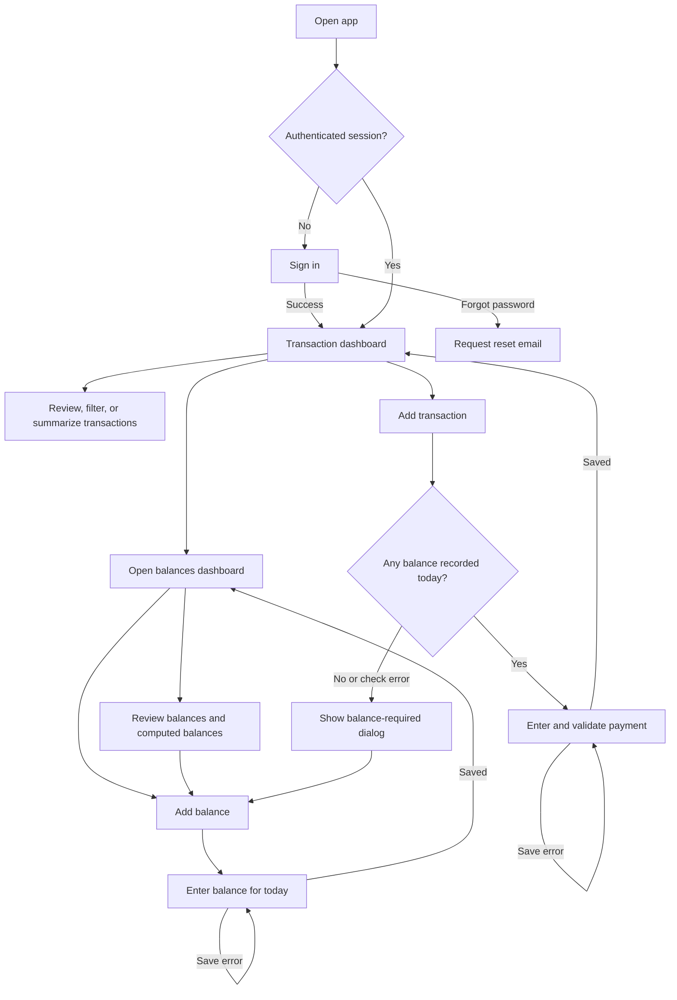

# Application Business Flow

## Purpose

Digital Payment lets authorized users record wallet and bank transactions, record wallet balances, and review daily activity. It is a record-keeping app; it does not initiate or settle transfers.

This document describes the current application behavior. Items marked **Confirm** describe behavior that may need a product decision before it is treated as an intended business rule.

## High-level user journey

## Sign-in and access

1. `/` sends the visitor to `/login`.
2. A user signs in with an email and password. Public sign-up, magic-link sign-in, and third-party providers are not offered in the app.
3. A successful sign-in sends the user to `/dashboard`. A signed-in user who opens `/login` is also redirected there.
4. Middleware protects `/dashboard`, `/balances`, `/transactions/new`, and `/balances/new`. A missing or invalid session sends the visitor to `/login`.
5. `/privacy` and `/terms` are public pages.

### Password recovery

The login screen allows a user to request a password reset email. The current redirect target is `/dashboard`. **The app does not currently provide a password-update screen after the recovery link is opened**, so the recovery journey is incomplete. Production Supabase Auth must also have the deployed redirect URL allowlisted.

## Transaction dashboard

- The initial view shows transactions for today in the `Asia/Manila` time zone.
- Users can select today or an earlier date. Future dates are disallowed.
- Changing the date fetches records asynchronously and shows skeletons while waiting; the page should not reload.
- Users can filter by payment type and device, sort records, and switch between table and card views.
- The summary dialog shows totals for the currently filtered transactions.
- Its consolidated total is:

  `cash-in and load amount + charges − cash-out amount`

- The copy control copies the consolidated amount with two decimal places and no currency symbol or grouping commas.

## Balances dashboard

- The initial view shows records for today. Users can select today or an earlier date, and date changes fetch data asynchronously with skeletons.
- The dashboard shows recorded balances and computes balance estimates from later payment activity through today.
- The current calculation is:

  `recorded balance − matching cash-in/load amounts + matching cash-out amounts`

- A transaction is matched to a balance by wallet type and by being on or after the balance date. **The current calculation does not match on device**, so transactions from other devices using the same wallet type can affect a balance row. Confirm whether that is intended.
- The dashboard shows the sum of recorded balances for the selected date. It does not show a combined total of computed balances.

## Add balance

1. The user opens `/balances/new` from the balances dashboard.
2. The user selects GCash or Maya and a device from the searchable option lists, enters an amount of zero or greater, and saves. The balance date is fixed to today in `Asia/Manila`.
3. The server validates the submitted type, device, date, and amount, verifies the session, and inserts the balance.
4. While saving, an overlay blocks form editing. On an error, entered values remain, the previous error clears on retry, and a new error is focused and scrolled into view.
5. On success, the user returns to `/balances`.

## Add transaction

1. The user opens `/transactions/new`.
2. The page asynchronously verifies the session and checks whether at least one balance exists for today. A skeleton is shown while the checks are pending.
3. If no balance exists, or the balance check fails, the page shows a balance-required dialog. The current gate checks for any balance today; it does not require a matching wallet type or device.
4. With a balance present, the user selects a payment type and device, then enters payment date, time, amount, charge, optional transaction ID when allowed, and optional note.
5. Payment date must be yesterday or today. Transaction ID is required for every payment type except loads and is limited to four characters. Charge is suggested from the payment type and amount but can be edited.
6. The server validates all fields and rechecks that a balance exists today before inserting the payment. While saving, an overlay blocks editing.
7. On an error, entered values remain. The previous error clears on retry; a returned error is focused and scrolled into view. PostgreSQL unique-constraint error `23505` is displayed as “Duplicate transaction.”
8. On success, the user returns to `/dashboard`.

## Charges and amount rules

- GCash and Maya charges are calculated at ₱5 for every ₱500 slab.
- Bank charges are calculated at ₱5 for every ₱1,000 slab.
- Payment amount must be greater than zero; charge must be zero or greater.
- Loads do not require a transaction ID. Other supported payment types require one.

## Data access model

The current Supabase migration enables row-level security but grants every authenticated user read access to all payment and balance rows. Authenticated users can also insert balances; payment inserts are associated with the signed-in user. Account creation is hidden in the app UI, but it must also be disabled in Supabase Auth if only administrator-created accounts are allowed.

## Related specifications

- [Supabase Auth UI](supabase-auth-ui.md)
- [Integration testing](../../INTEGRATION_TESTING.md)
- [UI automation testing](../../UI_AUTOMATION_TESTING.md)
